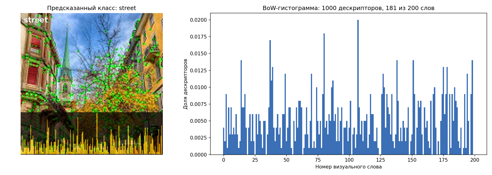

# Классификация изображений методом «мешок визуальных слов»

Практическая работа №2. Классификация изображений набора данных Intel Image Classification
с помощью BoW-гистограмм по классическим дескрипторам (OpenCV) и признакам сверточных сетей (PyTorch).

## Содержание

1. [Постановка задачи](#постановка-задачи)
2. [Набор данных](#набор-данных)
3. [Структура проекта](#структура-проекта)
4. [Как работает пайплайн](#как-работает-пайплайн)
5. [Экстракторы признаков](#экстракторы-признаков)
6. [Обоснование выбора методов и гиперпараметров](#обоснование-выбора-методов-и-гиперпараметров)
7. [Запуск](#запуск)
8. [Результаты](#результаты)
9. [Источники](#источники)

## Постановка задачи

По изображению нужно определить один из 6 классов сцены: `buildings`, `forest`, `glacier`,
`mountain`, `sea`, `street`. Изображение описывается BoW-гистограммой: локальные дескрипторы
сопоставляются ближайшим «визуальным словам» (центроидам K-средних), а частоты слов образуют
вектор фиксированной длины K. По этим векторам обучается классификатор.

## Набор данных

[Intel Image Classification](https://www.kaggle.com/datasets/puneet6060/intel-image-classification) [15] содержит
14 034 обучающих и 3 000 тестовых изображений 150×150, 6 классов, а также около 7 300 неразмеченных
изображений в `seg_pred`, они удобны для режима `predict`. Классы хорошо сбалансированы
(437–553 тестовых изображений на класс).

## Структура проекта

```
ZagriadskovMA/2_ImageClassification/
├── main.py                 # разбор аргументов, логирование, точка входа main()
├── requirements.txt
├── README.md
├── bow/
│   ├── __init__.py
│   ├── utils.py            # read_image, resize_keep_aspect
│   ├── extractors.py       # FeatureExtractor и наследники, фабрика FeatureExtractor.create
│   ├── bow.py              # BagOfWords: словарь, гистограммы, классификатор, save/load
│   ├── data.py             # DataLoader, IntelImageDataLoader, CsvDataLoader
│   ├── visualization.py    # plot_histogram, draw_histogram_overlay, visualize_image_with_histogram
│   └── pipelines.py        # run_train, run_test, run_predict
├── dataset/                # набор данных (не входит в репозиторий)
│   ├── seg_train/seg_train/{buildings,forest,glacier,mountain,sea,street}/*.jpg
│   ├── seg_test/seg_test/{...}/*.jpg
│   └── seg_pred/seg_pred/*.jpg
├── models/                 # обученные модели <экстрактор>_svm.joblib
└── results/                # логи обучения/теста, отчёты, CSV с предсказаниями, картинки predict
```

### Классы и функции

| Модуль | Класс / функция | Назначение |
|---|---|---|
| `utils.py` | `read_image(path)` | Чтение изображения через `np.fromfile` + `cv2.imdecode`. В отличие от `cv2.imread`, работает с путями на кириллице |
| | `resize_keep_aspect(image, size)` | Масштабирование по большей стороне с сохранением пропорций |
| `extractors.py` | `FeatureExtractor` | Абстрактный интерфейс: `detect_and_compute(image) -> (keypoints, descriptors N×D)`, фабрика `create(name, **params)`, `get_params()` для сохранения в модель |
| | `ClassicalExtractor` | Общая часть SIFT/ORB: увеличение изображения, перевод в серый, `detectAndCompute`, пересчёт координат точек |
| | `SiftExtractor`, `OrbExtractor` | Создание детектора и постобработка дескрипторов (RootSIFT / распаковка битов ORB) |
| | `CnnExtractorBase` | Предобработка изображения, извлечение карты признаков заданного слоя, превращение её в дескрипторы, выбор устройства |
| | `ResNet50Extractor`, `EfficientNetB0Extractor` | Загрузка модели torchvision с весами ImageNet и слой по умолчанию |
| `bow.py` | `BagOfWords` | `build_vocabulary` (PCA + K-средних), `compute_histogram`, `fit_classifier`, `predict`, `save_model` / `load_model` |
| | `CLASSIFIERS` | Словарь доступных классификаторов scikit-learn |
| `data.py` | `DataLoader` | Абстрактный загрузчик: `class_names`, `get_samples(split) -> [(path, label)]`, ограничение `limit_per_class` |
| | `IntelImageDataLoader` | Формат «папка на класс» с вложенными `seg_train/seg_train` |
| | `CsvDataLoader` | Формат с разметкой в `train.csv` / `test.csv` |
| `visualization.py` | `plot_histogram` | График BoW-гистограммы с сохранением в файл |
| | `draw_histogram_overlay` | Наложение гистограммы, ключевых точек и метки класса на изображение средствами OpenCV |
| | `visualize_image_with_histogram` | Окно: изображение с наложением + график гистограммы |
| `pipelines.py` | `run_train`, `run_test`, `run_predict` | Пайплайны трёх режимов запуска |
| `main.py` | `parse_args`, `setup_logging`, `main` | Аргументы командной строки, логирование (`logging`), обработка ошибок |

Иерархия экстракторов:

```
FeatureExtractor (ABC)            detect_and_compute(image) -> (keypoints, descriptors N×D)
├── ClassicalExtractor (ABC)      resize до 300 px, перевод в серый, cv2 detectAndCompute
│   ├── SiftExtractor   "sift"    cv2.SIFT_create, RootSIFT, D = 128
│   └── OrbExtractor    "orb"     cv2.ORB_create, биты дескриптора распакованы, D = 256
└── CnnExtractorBase (ABC)        карта признаков C×H×W -> H·W дескрипторов размерности C
    ├── ResNet50Extractor        "resnet50"         слой layer4,     D = 2048 (после PCA 128)
    └── EfficientNetB0Extractor  "efficientnet_b0"  слой features.8, D = 1280 (после PCA 128)
```

Наследники регистрируются автоматически через `__init_subclass__`, поэтому
`FeatureExtractor.create("sift")` возвращает `SiftExtractor`, а новый экстрактор достаточно
просто объявить с атрибутом `name`.

## Описание работы проекта в типовых задачах

### Общее описание

Классификатору (SVM и т.п.) нужен вектор признаков **фиксированной длины**. При этом локальных
дескрипторов на изображении разное количество: у SIFT от нескольких сотен до 1000 векторов
по 128 чисел. BoW решает это так же, как в анализе текстов, где документ описывается частотами слов
словаря, а порядок слов не учитывается:

1. Строим **словарь** из K «типичных» дескрипторов — визуальных слов.
2. Каждый дескриптор изображения заменяем номером ближайшего слова.
3. Считаем, сколько раз встретилось каждое слово: получается **гистограмма длины K**, одинаковой
   для любого изображения.
4. Гистограмма и есть вектор признаков для классификатора.

```
                         ОБУЧЕНИЕ (train)
 2000 случайных обучающих     ┌──────────────┐  ≤100 дескр.   ┌──────┐   ┌────────────┐
 изображений ───────────────► │  экстрактор  ├──с картинки──► │ PCA* ├──►│ K-средних  ├──► словарь
                              └──────────────┘   (≤200 000)   └──────┘   └────────────┘   K×D'
                                                                                            │
 все 14 034 обучающих         ┌──────────────┐   N×D   ┌──────┐   ┌─────────────────┐       │
 изображения ───────────────► │  экстрактор  ├────────►│ PCA* ├──►│ ближайшее слово ├◄──────┘
                              └──────────────┘         └──────┘   └────────┬────────┘
                                                                           │ N номеров слов
                                                         ┌─────────────────▼───────────────┐
                                                         │ гистограмма K, L1-нормировка    │
                                                         │ (+ TF-IDF при --tfidf)          │
                                                         └─────────────────┬───────────────┘
                                                         14 034 × K        ▼
                                                         ┌──────────────────────────────────┐
                                                         │ StandardScaler + SVM (RBF)       │──► модель .joblib
                                                         └──────────────────────────────────┘

                         ПРЕДСКАЗАНИЕ (test / predict)
 изображение ─► экстрактор ─► PCA* ─► ближайшее слово ─► гистограмма ─► SVM ─► класс
                                     (тот же словарь)    (та же нормировка)

 * PCA только для CNN-экстракторов (по умолчанию до 128 измерений)
```

### Шаг 1. Извлечение локальных дескрипторов

`extractor.detect_and_compute(image)` возвращает матрицу N×D: N локальных дескрипторов
размерности D. Каждый описывает небольшую область изображения. Принципы работы экстракторов
описаны в разделе [Экстракторы признаков](#экстракторы-признаков).

| Экстрактор | N на изображение (среднее по тесту) | D |
|---|---|---|
| ORB | ~913 | 256 |
| SIFT | ~894 | 128 |
| EfficientNet-B0 | 100 (сетка 10×10) | 1280 → 128 после PCA |
| ResNet-50 | 100 (сетка 10×10) | 2048 → 128 после PCA |

### Шаг 2. Построение словаря (`BagOfWords.build_vocabulary`)

1. **Подвыборка изображений** (`--vocab-images`, 2000). Словарь строится не по всем изображениям,
   а по случайной подвыборке. Дескрипторы всех 14 тыс. изображений SIFT — это около 12.5 млн векторов
   (или 6 ГБ float32). 2000 изображений (около 330 на класс) покрывает разнообразие классов.
2. **Подвыборка дескрипторов** (`--max-descriptors`, 200 000). С каждого изображения берётся
   не больше `max_descriptors // vocab_images` = 100 случайных дескрипторов. Это ограничивает
   время K-средних и не даёт изображениям с множеством точек перевесить остальные.
   При K=200 см. ([Обоснование выбора гиперпараметров](#обоснование-выбора-методов-и-гиперпараметров)) на каждый центроид приходится в среднем 1000 точек.
3. **PCA** (`--pca-dim`, только для CNN, по умолчанию 128). Вычисляется функцией `cv2.PCACompute2`:
   данные центрируются, находятся собственные векторы ковариационной матрицы, и остаются 128
   векторов с наибольшими собственными числами, то есть направления наибольшей дисперсии.
   Дальше каждый дескриптор заменяется проекцией `y = E·(x − μ)`. Плюсы использования PCA:
   - время K-средних и поиска ближайшего слова пропорционально D, и переход 2048 → 128 ускоряет их в 16 раз;
   - каналы CNN сильно коррелируют, и большая часть дисперсии лежит в небольшом подпространстве;
   - в пространствах высокой размерности евклидовы расстояния «концентрируются» (все точки
     примерно равноудалены), и кластеризация работает хуже.

   PCA обучается один раз на выборке для словаря, сохраняется в модель (μ и E) и затем применяется
   ко **всем** дескрипторам, в том числе при тесте и предсказании.
4. **K-средних** (`cv2.kmeans`, `--vocab-size` K=200,  k-means++). Алгоритм ищет K центров, минимизирующих сумму квадратов расстояний от точек до
   ближайшего центра: по очереди относит точки к ближайшим центрам и пересчитывает центры как
   средние. Найденные K центров — это **словарь визуальных слов** (матрица K×D). Каждое слово —
   «прототип» часто встречающегося фрагмента: участок листвы, край крыши, рябь воды и т.п.

### Шаг 3. Переход от дескрипторов к гистограмме (`BagOfWords.compute_histogram`)

Для изображения с N дескрипторами:

1. Если есть PCA, дескрипторы проецируются тем же преобразованием.
2. **Квантование.** `cv2.BFMatcher(NORM_L2).match(descriptors, vocabulary)` находит для каждого
   дескриптора ближайший центроид. Результат — N номеров слов, например `[17, 17, 3, 150, 42, ...]`.
3. **Подсчёт.** `np.bincount(words, minlength=K)` превращает номера в вектор счётчиков длины K:
   `h[k]` = сколько дескрипторов изображения ближе всего к слову k.
4. **L1-нормировка.** `h = h / sum(h)`: счётчики становятся долями, и их сумма равна 1.
   Без этого изображение с 1000 точками и изображение с 300 точками давали бы гистограммы
   разного масштаба, хотя описывают одну и ту же сцену. После нормировки важен *состав*
   фрагментов, а не их число. Изображение без дескрипторов (бывает у однотонных картинок) даёт
   нулевой вектор.
5. **TF-IDF** (опционально, `--tfidf`). Каждый столбец умножается на
   `idf = ln((1 + N_img) / (1 + df)) + 1`, где N_img — число обучающих изображений, df — число
   изображений, в которых слово встретилось. Слова, которые есть почти везде, получают меньший вес,
   редкие — больший. Затем выполняется повторная L1-нормировка. Единица в числителе и знаменателе добавлена для сглаживания и имитирует изображение со всеми словами, исключает деление на
   ноль. Прибавление единицы всему выражению присваивает частым словам 1 вместо 0.

Пример: K=5, у изображения 8 дескрипторов с номерами слов `[0, 3, 3, 1, 3, 4, 0, 3]` →
счётчики `[2, 1, 0, 4, 1]` → гистограмма `[0.25, 0.125, 0, 0.5, 0.125]`.

### Шаг 4. Обучение классификатора (`BagOfWords.fit_classifier`)

Гистограммы всех обучающих изображений образуют матрицу 14 034 × K, к ней добавляются метки
классов. По умолчанию используется `StandardScaler` + `SVC(kernel="rbf", C=10, gamma="scale")`:

- **StandardScaler** приводит каждый столбец (слово) к нулевому среднему и единичной дисперсии.
- **SVM с RBF-ядром** строит разделяющую поверхность в пространстве гистограмм. Решение для нового
  вектора x: `f_c(x) = Σ_i α_i·y_i·exp(−γ‖x − x_i‖²) + b`, где x_i — опорные векторы (обучающие
  гистограммы у границы классов). Для 6 классов scikit-learn строит 6·5/2 = 15 бинарных
  классификаторов «один против одного», и побеждает класс, набравший больше голосов.

### Шаг 5. Сохранение модели (`BagOfWords.save_model`)

В файл `.joblib` сохраняются имя и параметры экстрактора,
словарь K×D', PCA (μ, E), IDF-веса, обученный классификатор (вместе со StandardScaler) и имена классов.
`BagOfWords.load_model` восстанавливает экстрактор фабрикой `FeatureExtractor.create`.

### Как происходит предсказание

Предсказание для нового изображения (`BagOfWords.predict`) повторяет шаги 1–3 **с теми же
сохранёнными объектами**, а затем применяет классификатор:

1. Выбранный в модели экстрактор с фиксированными параметрами (размер, слой, число точек) извлекает N дескрипторов.
2. Аналогичная PCA-проекция (для CNN).
3. Каждый дескриптор относится к ближайшему слову **из сохранённого словаря**.
4. Гистограмма нормируется так же, как при обучении (L1 и IDF-веса обучающей выборки).
5. StandardScaler вычитает средние и делит на дисперсии, **запомненные на обучении**.
6. SVM вычисляет голоса 15 бинарных классификаторов и возвращает класс с наибольшим числом голосов.

Таким образом, изображения одного класса состоят из похожих фрагментов. Например, у `forest`
доминируют слова «листва» и «ветки», у `sea` — «рябь» и «горизонт». Поэтому их гистограммы
похожи, а у разных классов различаются. SVM запоминает, какие сочетания долей слов характерны
для какого класса. Расположение фрагментов на изображении при этом теряется, отсюда ограничения
BoW (см. [Анализ результатов](#анализ-результатов)).

В режиме `predict` дополнительно строится визуализация. Слева изображение, на котором зелёным
отмечены ключевые точки, то есть ровно те точки, чьи дескрипторы попали в гистограмму
(одна точка = один дескриптор = одно слово). Снизу на изображение наложена полупрозрачная гистограмма.
Справа отдельный график гистограммы, в заголовке которого указано число дескрипторов и сколько
из K слов встретилось. Многие точки SIFT/ORB совпадают по координатам: SIFT может дать одной точке
несколько ориентаций, а ORB ищет точки на 8 масштабах. 



### Нормировки

Нормировки выполняются на двух уровнях и решают разные задачи:

| Уровень | Где | Что делает | Зачем |
|---|---|---|---|
| Дескриптор | SIFT: RootSIFT (L1 + √) | вектор становится единичной L2-нормы | евклидово расстояние = ядро Хеллингера, лучше для гистограмм градиентов [5]; меньше влияние контраста |
| Дескриптор | CNN: L2-нормировка каждой строки | вектор единичной длины | длина вектора активаций зависит от контраста и яркости участка; после нормировки K-средних сравнивает только направление, исключая яркость |
| Дескриптор | ORB | не нужна | все векторы бинарные (0/1), расстояние = Хэмминг |
| Гистограмма | все экстракторы: L1 | счётчики → доли | независимость от числа точек на изображении |
| Гистограмма | TF-IDF (опц.) | вес слова по редкости | снижает вклад частых слов |
| Признак | StandardScaler | столбцы → среднее 0, дисперсия 1 | одинаковый вклад редких и частых слов в RBF-ядро |

Экспериментально подтверждено, что если использовать StandardScaler, TF-IDF почти ничего не меняет: умножение столбца на константу idf сокращается при стандартизации (хотя в [2] TF-IDF давал прирост точности). TF-IDF по умолчанию выключен.

## Экстракторы признаков

### Классические (OpenCV)

Перед извлечением изображение 150×150 увеличивается до 300 px (`--image-size`) и переводится в
оттенки серого. У детекторов параметры заданы в пикселях. Например, ORB не берёт точки ближе
31 px к краю, и на исходном 150×150 осталась бы только центральная треть кадра. Увеличение не
добавляет информации, но делает мелкие структуры доступными детектору.

**SIFT** [3] (`cv2.SIFT_create`):
1. Строится пирамида изображений, размытых гауссианами разного масштаба. Ключевые точки — локальные
   экстремумы разности соседних уровней (Difference of Gaussians) по координатам и масштабу.
   Так у каждой точки появляется свой размер, и метод инвариантен к масштабу.
2. По гистограмме направлений градиентов в окрестности определяется доминирующая ориентация.
   Окрестность поворачивается к ней, что даёт инвариантность к повороту.
3. Окрестность делится на сетку 4×4, в каждой ячейке считается гистограмма 8 направлений градиента:
   4·4·8 = 128 чисел.
4. Применяется RootSIFT [5]: L1-нормировка и поэлементный квадратный корень.

Остаются `--nfeatures` (1000) самых сильных точек. На большинстве изображений Intel при 300 px
SIFT находит больше 1000 точек (медиана после ограничения — ровно 1000, среднее 897), так что
ограничение реально срабатывает.

**ORB** [4] (`cv2.ORB_create`):
1. Детектор **FAST**: пиксель — угол, если на окружности из 16 пикселей вокруг него есть дуга
   заметно светлее или темнее центра. Точки ранжируются мерой Харриса и ищутся на 8 уровнях
   пирамиды масштабов. Порог FAST понижен до 10, чтобы находить точки на однородных сценах (море, ледник).
2. Ориентация определяется по направлению от центра окрестности к её «центру масс» яркости.
3. Дескриптор **rBRIEF**: 256 сравнений яркостей заранее выбранных пар пикселей (повёрнутых по
   ориентации), «светлее — 1, темнее — 0». Итого 256 бит = 32 байта.
4. Биты распаковываются в вектор из 256 нулей и единиц (`np.unpackbits`). Квадрат евклидова
   расстояния между такими векторами равен расстоянию Хэмминга, поэтому к ним можно применять
   обычный K-средних (ср. k-majority в [6]).

### Нейросетевые (PyTorch)

Сеть, обученная на ImageNet, используется **без дообучения** как извлекатель признаков [12].
Берётся выход последнего свёрточного слоя (размер C×H×W) до global average pooling и
классификационной головы. Каждая позиция (i, j) карты — вектор из C чисел, описывающий участок
изображения размером ~32×32 px входа (рецептивное поле нейронов этого слоя).
Получается H·W локальных дескрипторов, которые обрабатываются, как в случае с SIFT [9, 10].

**Предобработка** (`CnnExtractorBase.preprocess`), одинаковая для обеих сетей:

1. `cv2.resize` до `input_size × input_size` (по умолчанию 320), бикубическая интерполяция.
   Center crop не используется: изображения квадратные, обрезка потеряла бы края сцены.
   Вход 320 вместо стандартных 224 даёт карту 10×10 = 100 дескрипторов вместо 7×7 = 49.
   Свёрточная часть сети работает с любым размером входа.
2. `cv2.dnn.blobFromImage(scalefactor=1/255, swapRB=True)`: BGR → RGB (OpenCV читает BGR, а сети
   обучались на RGB), значения в [0, 1], раскладка HWC → NCHW.
3. Нормировка по каналам `(x − mean) / std`, mean = (0.485, 0.456, 0.406), std = (0.229, 0.224, 0.225).
   Это статистика ImageNet, на которой обучались веса torchvision. Без неё распределение входа не
   совпадает с обучающим, и признаки искажаются.

**Обработка выхода сети:** выход слоя извлекается через
`torchvision.models.feature_extraction.create_feature_extractor`, вычисления идут в режиме
`model.eval()` и `torch.no_grad()`. Тензор 1×C×H×W переставляется в матрицу (H·W)×C, каждая строка
L2-нормируется. «Ключевые точки» для визуализации — центры ячеек сетки, пересчитанные в координаты
исходного изображения. Классификационная голова сети (GAP + FC + softmax на 1000 классов ImageNet)
не используется.

| | ResNet-50 [7] | EfficientNet-B0 [8] |
|---|---|---|
| Веса torchvision | `IMAGENET1K_V2` (top-1 80.9%) | `IMAGENET1K_V1` (top-1 77.7%) |
| Параметров | 25.6 млн | 5.3 млн |
| Слой | `layer4` (выход 4-й стадии residual-блоков) | `features.8` (финальная свёртка 1×1) |
| Выход при входе 320 | 2048×10×10 | 1280×10×10 |
| Дескриптор после PCA | 128 | 128 |

**Устройство.** `--device auto` (по умолчанию) выбирает CUDA, если доступна в `PyTorch`, иначе используется CPU.
Если запрошена `cuda`, а она недоступна (нет видеокарты или установлена CPU-сборка PyTorch),
выводится предупреждение и работа продолжается на CPU.

## Обоснование выбора методов и гиперпараметров

### Экстракторы

* **SIFT** — стандартный дескриптор для BoW [1, 3]. На наборе из 8 классов сцен, похожем на Intel,
  BoW по SIFT даёт 0.55 с k-NN и до 0.83 с dense-SIFT и SVM [11].
* **ORB** — быстрая бинарная альтернатива SIFT [4, 6]. Взят для сравнения вещественного и бинарного
  дескриптора, а также скорости.
* **ResNet-50 и EfficientNet-B0**. Признаки сетей, предобученных на ImageNet, хорошо переносятся на
  другие задачи без дообучения [12]. Качество переноса растёт с точностью сети на ImageNet [13].
  Выход свёрточного слоя как набор локальных дескрипторов для бесструктурного кодирования
  (BoW/VLAD/Fisher) — подход [9, 10]. ResNet-50 — классическая архитектура с остаточными связями.
  EfficientNet-B0 даёт сопоставимую точность на ImageNet при впятеро меньшем числе параметров.
* **Почему не Xception.** В статье, посвященной исследованию задачи классификации на датасете Intel Classification в [14, табл. 6] Xception с GAP-головой даёт 0.879, а ResNet-50 — 0.820.
  Однако, в статье сети обучались **с нуля, end-to-end**, без ImageNet-весов. К BoW по замороженным
  предобученным признакам эти цифры не переносятся. Кроме того, Xception нет в torchvision.

### Классификатор: SVM

Ниже приводятся таблицы, представленные в [11] со сравнением классификаторов поверх BoW по dense-SIFT на 8 классах сцен (2688 изображений, точность, 8-кратная кросс-валидация):

| Классификатор | Точность |
|---|---|
| k-NN | 0.74 |
| Логистическая регрессия | 0.79 |
| **SVM** | **0.83** |

| Ядро SVM | Точность (среднее ± ст. откл.) |
|---|---|
| Линейное | 0.77 ± 0.03 |
| Полиномиальное | 0.76 ± 0.03 |
| **RBF** | **0.83 ± 0.02** |
| Сигмоидное | 0.81 ± 0.02 |
| Пересечение гистограмм | 0.81 ± 0.02 |

Это подтверждается на Intel (SIFT, K=500, тестовая выборка):

| Классификатор | Train | Test |
|---|---|---|
| **StandardScaler + SVM RBF, C=10 (по умолчанию)** | 0.999 | **0.727** |
| √гистограммы + SVM RBF, C=1 | 0.905 | 0.742 |
| χ²-отображение + LinearSVC | 0.803 | 0.721 |
| Random Forest (500 деревьев) | 0.999 | 0.688 |
| StandardScaler + логистическая регрессия | 0.777 | 0.685 |
| √гистограммы + k-NN (k=15) | 0.674 | 0.632 |

Для ORB порядок тот же: SVM 0.569–0.587, логистическая регрессия 0.544, RF 0.511, k-NN 0.42–0.45.
Ещё в первой работе по BoW [1] SVM заметно превзошёл наивный байесовский классификатор.

Точность на тестовой выборке Intel при разных K (остальные параметры по умолчанию, StandardScaler + SVM RBF):

| K | 50 | 100 | 200 | 500 | 1000 |
|---|---|---|---|---|---|
| ORB | — | 0.490 | 0.539 | 0.569 | 0.584 |
| SIFT | — | 0.700 | 0.711 | 0.727 | 0.730 |
| EfficientNet-B0 | 0.907 | 0.915 | 0.923 | 0.928 | — |
| ResNet-50 | 0.892 | 0.896 | 0.899 | 0.913 | — |

При всех экстракторах точность растёт с K, но рост замедляется: удвоение K даёт всё меньший
прирост. В [11] на сценах качество BoW растёт до K=512 и дальше не увеличивается, а вычисления
заметно дорожают. В [1] также приводится рост с выходом на плато к K≈1000.

K=200 выбран как компромисс точности и стоимости:
- для SIFT/ORB переход 200 → 1000 даёт +2–4 п.п., но в 5 раз увеличивает время K-средних,
  поиска ближайшего слова и размер вектора для SVM. Время K-средних растёт линейно с K
  (для SIFT при K=200 — 30 с, при K=1000 — по линейной оценке около 2.5 мин);
- для CNN переход 200 → 500 даёт +0.5 п.п. (EfficientNet-B0) и +1.3 п.п. (ResNet-50) при
  увеличении времени обучения SVM в ~3 раза. На изображение приходится всего 100 дескрипторов,
  поэтому при K=500 больше 80% столбцов каждой гистограммы нулевые.

## Инструкции по запуску

### Настройка окружения

```bash
python -m venv venv
venv\Scripts\activate
pip install -r requirements.txt
```

**Замечание:** `pip install torch` на Windows устанавливает CPU-сборку PyTorch. Для работы с GPU нужна CUDA-сборка, команду для своей версии CUDA можно получить на https://pytorch.org/get-started/locally/.

### Загрузка набора данных

Скрипт `download_dataset.py` скачивает архив Intel Image Classification с Kaggle (346 МБ),
распаковывает его в `dataset/` и проверяет структуру каталогов:

```bash
python download_dataset.py
```

| Флаг | По умолчанию | Описание |
|---|---|---|
| `--output` | `dataset` | Каталог для распаковки |
| `--archive` | `intel-image-classification.zip` | Путь к архиву: если файл существует, он распаковывается без скачивания, иначе архив скачивается в этот путь |
| `--keep-archive` | выкл. | Не удалять скачанный архив после распаковки |
| `--force` | выкл. | Удалить существующий каталог `--output` и распаковать заново (без флага существующие данные не трогаются) |
| `--url` | адрес Kaggle API | Адрес архива |

### Примеры запуска

Обучение:

```bash
python main.py train --data-root dataset --extractor efficientnet_b0 --model models/efficientnet_b0_svm.joblib
```

Тестирование:

```bash
python main.py test --data-root dataset --model models/efficientnet_b0_svm.joblib --output results/efficientnet_b0_svm.csv
```

Предсказание:

```bash
python main.py predict --model models/efficientnet_b0_svm.joblib --image dataset/seg_pred/seg_pred/10004.jpg --save-dir results/predict_example
```

### Аргументы командной строки

Общие (указываются **до** режима):

| Флаг | По умолчанию | Описание |
|---|---|---|
| `--log-level` | `INFO` | Подробность лога: `DEBUG`, `INFO`, `WARNING`, `ERROR` |
| `--log-file` | — | Дополнительно писать лог в файл |

`train` — обучение:

| Флаг | По умолчанию | Описание |
|---|---|---|
| `--data-root` | обязателен | Корневой каталог набора данных (`dataset`) |
| `--dataset` | `intel` | Формат набора: `intel` (папки по классам) или `csv` (`train.csv` / `test.csv`) |
| `--limit-per-class` | все | Взять не больше N изображений каждого класса (для отладки) |
| `--extractor` | обязателен | `sift`, `orb`, `resnet50`, `efficientnet_b0` |
| `--model` | обязателен | Путь для сохранения модели `.joblib` |
| `--vocab-size` | 200 | Число визуальных слов K (центроидов K-средних) |
| `--classifier` | `svm` | `svm` (RBF), `linear_svm`, `logreg`, `rf`, `knn` |
| `--vocab-images` | 2000 | Сколько случайных обучающих изображений используется для построения словаря |
| `--max-descriptors` | 200 000 | Максимум дескрипторов для K-средних; с изображения берётся не больше `max_descriptors // vocab_images` |
| `--pca-dim` | 128 для CNN, нет для SIFT/ORB | Размерность PCA перед K-средних; `0` отключает PCA |
| `--tfidf` | выкл. | Взвешивать слова по TF-IDF |
| `--seed` | 42 | Зерно генератора случайных чисел (подвыборки, K-средних) |
| `--image-size` | 300 | SIFT/ORB: размер большей стороны изображения перед детектором |
| `--nfeatures` | 1000 | SIFT/ORB: максимум ключевых точек на изображение (самые сильные) |
| `--layer` | `layer4` / `features.8` | CNN: имя слоя, с которого берутся признаки |
| `--input-size` | 320 | CNN: размер входа сети; сетка дескрипторов = `input_size / 32` по каждой стороне |
| `--device` | `auto` | CNN: `auto`, `cpu` или `cuda` |

`test` — тестирование: `--data-root`, `--dataset`, `--limit-per-class`, `--device`, а также:

| Флаг | По умолчанию | Описание |
|---|---|---|
| `--model` | обязателен | Файл обученной модели |
| `--output` | — | CSV-файл с колонками `path, true, predicted` для каждого тестового изображения |

Выводит accuracy, отчёт по классам (precision / recall / F1) и матрицу ошибок.

`predict` — одно изображение:

| Флаг | По умолчанию | Описание |
|---|---|---|
| `--model` | обязателен | Файл обученной модели |
| `--image` | обязателен | Путь к изображению |
| `--save-dir` | — | Каталог для сохранения данных по предсказанию: `<имя>_with_histogram.png` (изображение + гистограмма) и `<имя>_histogram.png` (только гистограмма) |
| `--no-show` | выкл. | Не открывать окно с графиком (только сохранить) |
| `--draw-keypoints` | выкл. | Отметить на изображении ключевые точки (центры ячеек для CNN) |
| `--device` | `auto` | Устройство для CNN |

Параметры экстрактора задаются только при обучении и сохраняются в модель. `test` и `predict`
берут их из файла модели.

## Результаты

### Инфраструктура

Все замеры выполнены на одном компьютере:

- CPU Intel Core i5-12400F (6 ядер / 12 потоков), 64 ГБ DDR4;
- GPU NVIDIA GeForce RTX 3060 12 ГБ;
- Windows 11 Pro 25H2;
- Python 3.13.7, OpenCV 5.0.0, PyTorch 2.14.1+cu126, torchvision 0.29.1, scikit-learn 1.8.0.

### Точность

Все модели обучены с одинаковыми гиперпараметрами по умолчанию: K=200, StandardScaler + SVM RBF (C=10),
словарь по 2000 изображениям / 200 000 дескрипторам, PCA до 128 для CNN, без TF-IDF.

| Экстрактор | Train | **Test** | Macro F1 (test) |
|---|---|---|---|
| ORB | 0.9993 | **0.5393** | 0.540 |
| SIFT | 0.9988 | **0.7110** | 0.716 |
| ResNet-50 | 0.9986 | **0.8993** | 0.902 |
| EfficientNet-B0 | 0.9967 | **0.9230** | 0.925 |

Результаты CNN немного меняются от запуска к запуску (около ±1 п.п.): словарь зависит от
случайной подвыборки.

### Матрицы ошибок (тестовая выборка, строки — истинный класс, столбцы — предсказанный)

Порядок классов: buildings, forest, glacier, mountain, sea, street.

**ORB** (0.5393)

| | buildings | forest | glacier | mountain | sea | street |
|---|---|---|---|---|---|---|
| **buildings** | **234** | 33 | 26 | 27 | 35 | 82 |
| **forest** | 17 | **368** | 15 | 19 | 14 | 41 |
| **glacier** | 28 | 17 | **292** | 102 | 67 | 47 |
| **mountain** | 37 | 37 | 98 | **238** | 58 | 57 |
| **sea** | 39 | 22 | 103 | 80 | **220** | 46 |
| **street** | 59 | 56 | 48 | 46 | 26 | **266** |

**SIFT** (0.7110)

| | buildings | forest | glacier | mountain | sea | street |
|---|---|---|---|---|---|---|
| **buildings** | **311** | 5 | 4 | 3 | 11 | 103 |
| **forest** | 2 | **436** | 5 | 12 | 12 | 7 |
| **glacier** | 2 | 5 | **359** | 115 | 67 | 5 |
| **mountain** | 4 | 5 | 117 | **316** | 76 | 7 |
| **sea** | 12 | 13 | 71 | 69 | **332** | 13 |
| **street** | 80 | 13 | 7 | 4 | 18 | **379** |

**ResNet-50** (0.8993)

| | buildings | forest | glacier | mountain | sea | street |
|---|---|---|---|---|---|---|
| **buildings** | **398** | 0 | 0 | 0 | 3 | 36 |
| **forest** | 0 | **471** | 3 | 0 | 0 | 0 |
| **glacier** | 0 | 3 | **439** | 93 | 18 | 0 |
| **mountain** | 2 | 2 | 71 | **442** | 7 | 1 |
| **sea** | 3 | 0 | 16 | 2 | **488** | 1 |
| **street** | 39 | 0 | 0 | 2 | 0 | **460** |

**EfficientNet-B0** (0.9230)

| | buildings | forest | glacier | mountain | sea | street |
|---|---|---|---|---|---|---|
| **buildings** | **404** | 0 | 0 | 0 | 3 | 30 |
| **forest** | 0 | **472** | 1 | 1 | 0 | 0 |
| **glacier** | 0 | 1 | **467** | 70 | 15 | 0 |
| **mountain** | 1 | 3 | 63 | **453** | 4 | 1 |
| **sea** | 0 | 3 | 3 | 3 | **501** | 0 |
| **street** | 24 | 0 | 1 | 1 | 3 | **472** |

Полные отчёты (precision / recall / F1 по классам) — в `results/<экстрактор>_test_report.txt`,
предсказания для каждого изображения — в `results/<экстрактор>_svm.csv`.

### Время работы

Время извлечения дескрипторов и полного предсказания одного изображения (извлечение + PCA + гистограмма + SVM),
среднее по 300 тестовым изображениям:

| Экстрактор | Устройство | Извлечение, мс/изобр. | Полное предсказание, мс/изобр. |
|---|---|---|---|
| ORB | CPU | **4.0** | **7.2** |
| SIFT | CPU | 12.3 | 14.9 |
| EfficientNet-B0 | CPU | 24.4 | 34.5 |
| EfficientNet-B0 | CUDA | 9.3 | 18.6 |
| ResNet-50 | CPU | 75.7 | 91.3 |
| ResNet-50 | CUDA | 7.9 | 23.2 |

Полное время режимов `train` и `test` на всём наборе (SIFT/ORB на CPU, CNN на CUDA):

| Экстрактор | Дескрипторы для словаря (2000 изобр.) | PCA + K-средних | Гистограммы train (14 034 изобр.) | Обучение SVM | **Всего train** | **test** (3000 изобр.) |
|---|---|---|---|---|---|---|
| ORB | 10 с | 55 с | 84 с | 35 с | **3 мин 04 с** | 22 с |
| SIFT | 31 с | 30 с | 217 с | 24 с | **5 мин 03 с** | 49 с |
| EfficientNet-B0 (CUDA) | 19 с | 2 мин 34 с | 242 с | 9 с | **7 мин 05 с** | 58 с |
| ResNet-50 (CUDA) | 16 с | 5 мин 50 с | 336 с | 11 с | **11 мин 54 с** | 76 с |

У CNN заметную часть обучения занимает PCA: ковариационная матрица по 200 000 векторам
размерности 2048 (1280) считается на CPU. При полном предсказании на GPU основное время уходит
не на сеть, а на чтение изображения, гистограмму и SVM. У моделей CNN 5–6 тыс. опорных векторов,
у SIFT/ORB — 11–13 тыс., и решающая функция суммирует ядро по каждому из них.
На CPU обучение ResNet-50 заняло бы примерно на 18 минут дольше: (2000 + 14 034) × ~68 мс.

### Анализ результатов

**Качество признаков.** Извлекаемые CNN признаки намного лучше классических: 0.90–0.92 против 0.54–0.71.
Сеть, обученная на ImageNet, кодирует семантику участка («листва», «вода», «каменная стена»)
и учитывает цвет. SIFT и ORB описывают только локальную геометрию яркости серого изображения.
EfficientNet-B0 немного точнее ResNet-50 (+2.4 п.п.) при впятеро меньшем числе параметров.

**Скорость против точности.** ORB — самый быстрый метод: извлечение 4 мс на изображение на CPU,
что примерно **в 19 раз быстрее ResNet-50** на CPU (75.7 мс), а полное предсказание в 12.7 раза
быстрее (7.2 против 91.3 мс). Но точность ORB гораздо ниже (0.54 против 0.90). SIFT в 3 раза
медленнее ORB, но точнее на 17 п.п. Таким образом, лучший экстрактор для предсказаний, в том числе на CPU —
EfficientNet-B0: 34.5 мс на CPU и лучшая точность.

**Какие классы путаются.** У всех методов ошибки сосредоточены в двух группах:
- `glacier` ↔ `mountain` ↔ `sea`: снежные горы и ледники выглядят одинаково, море и ледник —
  большие однородные области. Для CNN это 63–93 ошибки в паре glacier ↔ mountain. Классы
  размечены неоднозначно: многие «горы» покрыты снегом.
- `buildings` ↔ `street`: на улицах есть здания, а на снимках зданий — улицы. Для SIFT это 80–103 ошибки,
  для CNN 24–39.

`forest` распознаётся почти идеально всеми методами (у SIFT recall 0.92): листва даёт характерную
текстуру. Различие этих групп во многом определяется цветом и расположением (небо сверху, вода
снизу), в том время, как SIFT/ORB работают с серым изображением, а BoW полностью отбрасывает расположение фрагментов.

**Почему ORB хуже SIFT.** Двоичные сравнения яркостей пар пикселей менее информативны, чем
гистограммы градиентов, и сильнее зависят от шума. Детектор углов FAST плохо подходит для
природных текстур без выраженных углов. Увеличение K для ORB даёт медленный рост (0.539 → 0.584 при
K 200 → 1000), а увеличение изображения больше 300 px почти ничего не даёт (0.539 → 0.549 при 450 px).

**Переобучение.** На обучающей выборке точность почти 1.0 у всех методов. Но для SIFT уменьшение
C с 10 до 1 снижает её до 0.889, а на тесте ничего не меняется (0.727 → 0.729 при K=500). Значит,
низкая точность классических методов объясняется не переобучением SVM, а ограниченной
информативностью самих признаков.

**Возможные улучшения** (проверены на SIFT, в проект не включены):
- пространственная пирамида: гистограммы отдельно для всего изображения и для трёх горизонтальных полос [11]: 0.727 → 0.786;
- √-нормировка гистограмм (ядро Хеллингера) вместо StandardScaler: +1–2 п.п.;
- dense SIFT вместо детектора [11];
- Fisher-векторы или VLAD вместо BoW [9, 10].

## Источники

1. Csurka G., Dance C., Fan L., Willamowski J., Bray C. Visual categorization with bags of keypoints // ECCV Workshop on Statistical Learning in Computer Vision, 2004.
2. Sivic J., Zisserman A. Video Google: a text retrieval approach to object matching in videos // ICCV, 2003.
3. Lowe D. G. Distinctive image features from scale-invariant keypoints // IJCV, 2004, 60(2), pp. 91–110.
4. Rublee E., Rabaud V., Konolige K., Bradski G. ORB: an efficient alternative to SIFT or SURF // ICCV, 2011.
5. Arandjelović R., Zisserman A. Three things everyone should know to improve object retrieval // CVPR, 2012.
6. Grana C., Borghesani D., Manfredi M., Cucchiara R. A fast approach for integrating ORB descriptors in the bag of words model // Proc. SPIE 8667, Multimedia Content and Mobile Devices, 2013. https://aimagelab.ing.unimore.it/imagelab/pubblicazioni/2013ElectronicImaging.pdf
7. He K., Zhang X., Ren S., Sun J. Deep residual learning for image recognition // CVPR, 2016.
8. Tan M., Le Q. EfficientNet: rethinking model scaling for convolutional neural networks // ICML, 2019.
9. Gong Y., Wang L., Guo R., Lazebnik S. Multi-scale orderless pooling of deep convolutional activation features // ECCV, 2014.
10. Cimpoi M., Maji S., Vedaldi A. Deep filter banks for texture recognition and segmentation // CVPR, 2015.
11. Lorente O., Riera I., Rana A. Image classification with classic and deep learning techniques // arXiv:2105.04895, 2021.
12. Razavian A. S., Azizpour H., Sullivan J., Carlsson S. CNN features off-the-shelf: an astounding baseline for recognition // CVPR Workshops, 2014.
13. Kornblith S., Shlens J., Le Q. V. Do better ImageNet models transfer better? // CVPR, 2019.
14. Rahimzadeh M., Askari A., Parvin S., Safi E., Mohammadi M. R. Wise-SrNet: a novel architecture for enhancing image classification by learning spatial resolution of feature maps // arXiv:2104.12294, 2021.
15. Intel Image Classification dataset. https://www.kaggle.com/datasets/puneet6060/intel-image-classification
